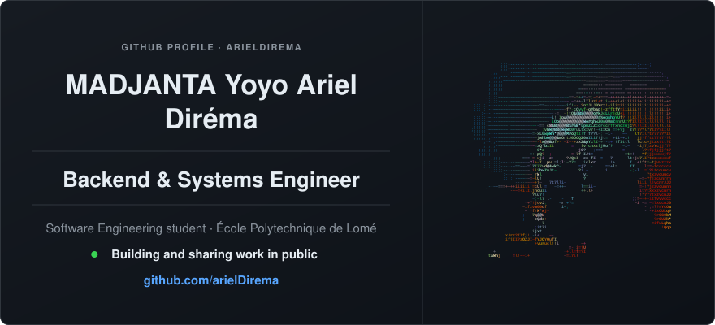
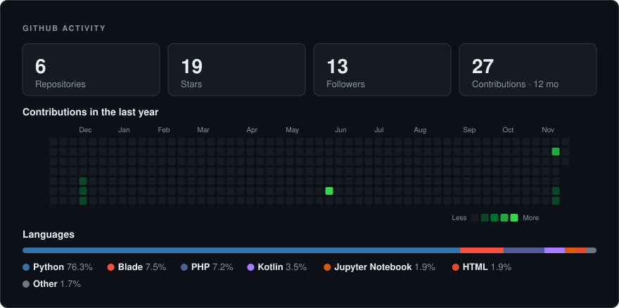

  

  
  
  
  

## About me

- Software engineering student at **École Polytechnique de Lomé**, Togo
- Focused on **backend and systems** work: APIs, data, and desktop tooling
- Currently building **[Dynamic Island for Windows 11](https://github.com/arielDirema/dynamic-island)**
- Shipping web applications with **Laravel**, **React** and **Next.js**
- Open to collaborations and internships, feel free to reach out

## Featured projects

<table>
<tr>
<td width="50%" valign="top">

### [Dynamic Island for Windows 11](https://github.com/arielDirema/dynamic-island)

A floating island that replaces the Windows taskbar: media, calendar, timers, tasks, app launcher with a dock of running apps, quick settings (Wi-Fi, Bluetooth, hotspot) and a smart clipboard. Packaged as an MSI and built by GitHub Actions.

  

</td>
<td width="50%" valign="top">

### [AlgoNumeriquesCodes](https://github.com/arielDirema/AlgoNumeriquesCodes)

Python implementations of numerical-analysis algorithms.

 

</td>
</tr>
</table>

## Tech stack

<table>
<tr><td><b>Languages</b></td><td></td></tr>
<tr><td><b>Frameworks</b></td><td></td></tr>
<tr><td><b>Databases</b></td><td></td></tr>
<tr><td><b>Tools</b></td><td></td></tr>
</table>

## GitHub activity

  

