<!-- Header -->
<p align="center">
  
</p>

<p align="center">
  <a href="https://github.com/arielDirema">
    
  </a>
</p>

<p align="center">
  
  <a href="https://github.com/arielDirema?tab=followers"></a>
  <a href="https://facebook.com/arielDirema"></a>
  
</p>

---

## &nbsp; About me

<table>
<tr>
<td width="55%" valign="top">

- 🎓 Software engineering student at **École Polytechnique de Lomé**
- 🪟 Currently building **[Dynamic Island for Windows 11](https://github.com/arielDirema/dynamic-island)**
- 🌐 Shipping web apps with **Laravel** and **React**
- 📱 Learning **Android** development with **Kotlin**
- 🤝 Looking to collaborate on tech projects — ask me anything
- ⚡ Fun fact: I am fun 😁

</td>
<td width="45%" valign="top">

```python
class Ariel:
    school   = "École Polytechnique de Lomé"
    based_in = "Lomé, Togo"
    building = "Dynamic Island for Windows"
    learning = ["Kotlin", "Android"]
    stack    = ["Laravel", "React",
                "Python", "Qt"]

    def say_hi(self):
        return "Let's build something!"
```

</td>
</tr>
</table>

---

## 🚀 Featured project

<table>
<tr>
<td width="50%" valign="middle">
  <a href="https://github.com/arielDirema/dynamic-island">
    
  </a>
</td>
<td width="50%" valign="middle">

### [Dynamic Island for Windows 11](https://github.com/arielDirema/dynamic-island)

A black floating island at the top of the screen that **replaces the Windows taskbar**: media, calendar,
timers & Pomodoro, tasks, app launcher with a dock of running apps, files, phone link, weather,
quick settings (Wi-Fi, Bluetooth, hotspot) and a smart clipboard.

<a href="https://github.com/arielDirema/dynamic-island/releases/latest"></a> <a href="https://github.com/arielDirema/dynamic-island/stargazers"></a> 

<a href="https://github.com/arielDirema/dynamic-island/releases/latest"></a>

</td>
</tr>
</table>

## 🧩 Other projects

<table>
<tr>
<td width="50%" valign="top">

**[AlgoNumeriquesCodes](https://github.com/arielDirema/AlgoNumeriquesCodes)**<br/>
<sub>Python implementations of numerical-analysis algorithms.</sub><br/>


</td>
<td width="50%" valign="top">

**[umoji](https://github.com/arielDirema/umoji)**<br/>
<sub>TypeScript project.</sub><br/>


</td>
</tr>
<tr>
<td width="50%" valign="top">

**[AnacApp](https://github.com/arielDirema/AnacApp)**<br/>
<sub>Kotlin project.</sub><br/>


</td>
<td width="50%" valign="top">

**[toDoLara](https://github.com/arielDirema/toDoLara)**<br/>
<sub>A simple to-do list built with Laravel.</sub><br/>


</td>
</tr>
<tr>
<td width="50%" valign="top">

**[PokeApi](https://github.com/arielDirema/PokeApi)**<br/>
<sub>The PokéAPI with HTML, CSS and JavaScript.</sub><br/>


</td>
<td width="50%" valign="top">

**[ToDoList](https://github.com/arielDirema/ToDoList)**<br/>
<sub>A to-do list in JavaScript.</sub><br/>


</td>
</tr>
</table>

---

## 🛠️ Tech stack

<table>
<tr><td><b>Languages</b></td><td></td></tr>
<tr><td><b>Frameworks</b></td><td></td></tr>
<tr><td><b>Databases</b></td><td></td></tr>
<tr><td><b>Tools</b></td><td></td></tr>
</table>

---

## 📊 GitHub activity

<p align="center">
  
  &nbsp;
  
</p>

<p align="center">
  
</p>

<p align="center">
  <picture>
    <source media="(prefers-color-scheme: dark)" srcset="https://raw.githubusercontent.com/arielDirema/arielDirema/output/github-snake-dark.svg"/>
    <source media="(prefers-color-scheme: light)" srcset="https://raw.githubusercontent.com/arielDirema/arielDirema/output/github-snake.svg"/>
    
  </picture>
</p>

<!-- Footer -->
<p align="center">
  
</p>
